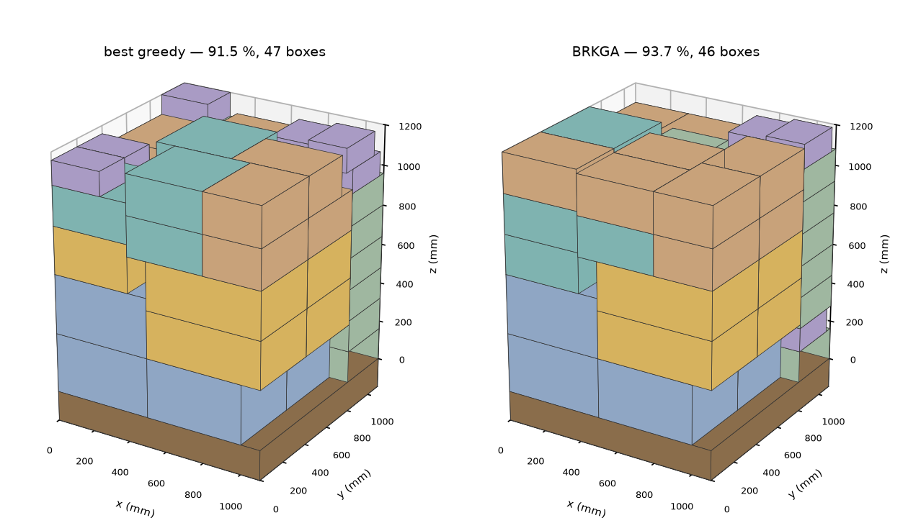
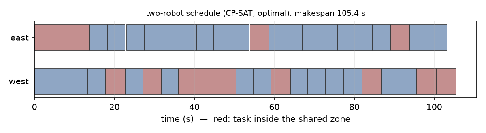
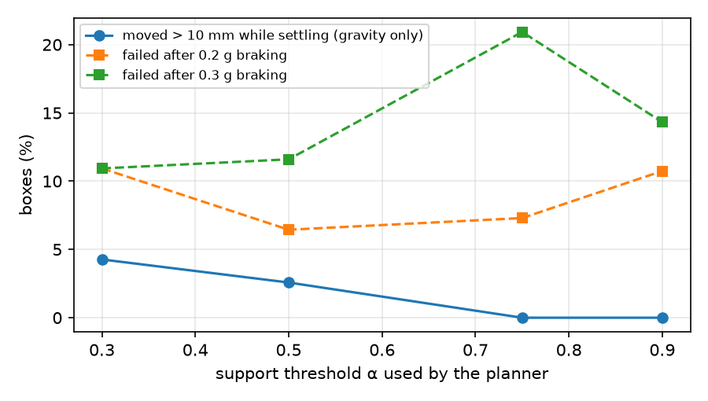

# Palletizing-Lab


**Mixed-case random palletizing and robot task optimization — from stacking plan to robot schedule, checked in physics.**

> Boxes of mixed sizes arrive at a palletizing cell in random order. Where should each one go, in what order should the robot place them, which of two robots should do it — and will the load actually stay up? This repository answers each question with combinatorial optimization (heuristics, metaheuristics, exact CP-SAT models, MCTS), then checks the answers in a MuJoCo physics simulation and connects them to point-cloud perception.



**Environment**: Python 3.10+ · NumPy · OR-Tools CP-SAT · MuJoCo 3 · `pytest` (CI on 3.11 / 3.13)

---

## 🧭 The pipeline

| Stage | Question | Methods | Module |
|---|---|---|---|
| Stacking plan | Where does each box go? | DBLF heightmap decoder, simulated annealing, BRKGA, exact CP-SAT | [`construct`](palletlab/construct.py), [`metaheuristics`](palletlab/metaheuristics.py), [`exact_cpsat`](palletlab/exact_cpsat.py) |
| Random palletizing | Boxes arrive one by one — what now? | buffer greedy, determinized MCTS (sample-average approximation) | [`online`](palletlab/online.py) |
| Task sequencing | In what order should the robot build it? | sequential ordering problem: greedy, SA, CP-SAT `AddCircuit` | [`sequencing`](palletlab/sequencing.py) |
| Task allocation | Which of two robots places which box, and when? | list scheduling, CP-SAT optional intervals + shared-zone `NoOverlap` | [`allocation`](palletlab/allocation.py) |
| Validation | Does the plan stay up — and survive braking? | MuJoCo rigid-body simulation | [`sim_mujoco`](palletlab/sim_mujoco.py) |
| Perception | Where do box sizes and the pallet state come from? | RANSAC, PCA + min-area rectangle, depth → heightmap | [`perception`](palletlab/perception.py) |

Every plan and schedule in every experiment is re-checked by an **independent validator** written with explicit geometry ([`validate_plan`](palletlab/geometry.py), [`check_schedule`](palletlab/allocation.py)) — not by the planner that produced it.

---

## 📐 The model in one paragraph

Korean standard **T-11 pallet** (1100 × 1100 mm), 1200 mm load height, 20 mm integer grid. The robot places boxes **from above**, so the load is represented by its top surface — a **heightmap**, which is also exactly what a top-down depth camera returns. A box may yaw 90° ("this side up") and must rest on the floor or have **at least α = 75 % of its bottom face supported** by boxes already placed.

*Why α > 0.5 is the meaningful threshold:* any line through the centre of a rectangle splits its area in half, so a support region larger than half the bottom face cannot lie on one side of such a line — the centre of gravity is inside the convex hull of the support, which is the static tipping condition for a rigid box. More in [`docs/design_notes.md`](docs/design_notes.md).

---

## 📊 Results

Full tables, settings and figures: [`docs/results/`](docs/results/). Each experiment is one script in [`experiments/`](experiments/).

### E1 · Stacking plans — search beats greedy rules

*Perfect* instances are made by cutting the pallet volume into boxes, so the optimum is **100 %** and utilization *is* the optimality gap.

| Instance (3 each) | greedy (DBLF) | Simulated annealing | BRKGA |
|---|---|---|---|
| perfect, 20 boxes | 67.5 % | 85.5 % | **88.3 %** |
| perfect, 30 boxes | 67.4 % | **82.4 %** | 80.3 % |
| perfect, 50 boxes | 62.2 % | 74.0 % | **74.6 %** |
| SKU mix, 60 boxes | 88.0 % | 91.7 % | **93.3 %** |

2000 decoder evaluations each (7–26 s). A summed-area-table decoder (7–13 ms per full plan, ~6× faster than testing positions one by one) is what makes this budget affordable.

### E2 · Exact CP-SAT model — where it stops scaling

CP-SAT is warm-started from the BRKGA plan and given 60 s (8 workers).

| Instance (3 each) | BRKGA | CP-SAT | Proven optimal | CP-SAT time |
|---|---|---|---|---|
| perfect, 12 boxes | 96.8 % | **100 %** | 3/3 | 0.3 s |
| perfect, 16 boxes | 88.0 % | **100 %** | 3/3 | 3.0 s |
| perfect, 20 boxes | 88.3 % | **100 %** | 3/3 | 13.9 s |
| perfect, 25 boxes | 80.0 % | 87.0 % | 0/3 | time limit |
| SKU mix, 60 boxes | 93.3 % | 93.4 % | 0/3 | time limit — bound never tightens |

Up to ~20 boxes the exact model finds *and proves* the optimum that the metaheuristics miss by 3–12 points; by 60 boxes it can barely improve the warm start. That is the practical division of labour: metaheuristics for full pallets, exact models for sub-problems (a layer, a zone) and for grading the heuristics.

### E3 · Random (online) palletizing — the buffer is the biggest lever

Same 10 random SKU streams for every policy; the episode ends when no visible box can be placed stably.

| Policy | Mean | Worst | Time / box |
|---|---|---|---|
| greedy, k = 1 (pure online) | 40.5 % | 23.7 % | 0.3 ms |
| buffer greedy, k = 3 | 59.8 % | 42.0 % | 0.8 ms |
| buffer greedy, k = 5 | **67.7 %** | **60.1 %** | 1.3 ms |
| MCTS, k = 3 | 61.7 % | 52.1 % | 612 ms |

Seeing three boxes instead of one is worth ~20 points; five, ~27. MCTS (sampled futures, rollouts to the end of the episode) adds only +1.9 points on average and wins 5 of 10 streams — its real gain is the **worst case** (52 % vs 42 %), at ~750× the compute. A longer conveyor buffer is a cheaper lever than a smarter search.


### E4 · Robot task sequencing and two-robot allocation

| | Result (5 plans, 40–46 boxes) |
|---|---|
| Build order (SOP, CP-SAT) | **10.6 %** less empty robot travel than layer-by-layer; **5/5 proven optimal** |
| Two robots + shared zone (CP-SAT) | **1.98×** faster than one robot; **7.8 %** shorter makespan than list scheduling (up to 17.7 %); **5/5 proven optimal** |



### E5 · Physics check in MuJoCo — static support is necessary, not sufficient

| α used by the planner | settle failures (gravity) | failures after 0.3 g braking |
|---|---|---|
| 0.30 | 4.3 % | 10.9 % |
| 0.50 | 2.6 % | 11.6 % |
| **0.75** | **0.0 %** | 20.9 % |
| 0.90 | 0.0 % | 14.3 % |



The support rule holds exactly where theory says it should: no box moves while settling once α ≥ 0.75. Braking is a different story — **95 % of the boxes that fail sit in free-standing single-support columns** (vs. 72 % of those that hold), and a rigid column tips when a/g > width / height ≈ 0.3. The stricter static rule even makes it worse, because it favours stacking same-size boxes straight up. Transport stability needs its own objective; see [limitations](#-limitations-and-next-steps).

### E6 · Perception — from point cloud to optimizer input

| | Result |
|---|---|
| Box on conveyor → SKU | **100 %** recognised (80 clouds per noise level, σ = 1–8 mm, 1 % outliers) |
| Dimensions | 90 % exact on the 20 mm grid, never more than one grid step off |
| Yaw | 0.8–1.2° mean error |
| Depth image → pallet heightmap | 100 % of cells exact up to σ = 8 mm, 99.4 % at 12 mm |

---

## 🚀 Quick start

```bash
git clone https://github.com/Sophia-Min12/Palletizing-Lab.git
cd Palletizing-Lab
pip install -e ".[dev]"

pytest                                   # 34 tests, ~10 s

python experiments/offline_search.py     # E1  ~12 min
python experiments/exact_vs_heuristic.py # E2  ~15 min
python experiments/online_random.py      # E3  ~5 min
python experiments/robot_tasks.py        # E4  ~5 min
python experiments/physics_check.py      # E5  ~4 min
python experiments/perception_eval.py    # E6  ~1 min
```

```python
from palletlab.geometry import T11, validate_plan
from palletlab.instances import random_boxes
from palletlab.metaheuristics import brkga

boxes = random_boxes(60, seed=0)
result = brkga(T11, boxes, max_evals=2000, seed=0)
print(f"{result.best.utilization:.1%}", validate_plan(T11, result.best.plan))  # 93.7% []
```

---

## 🗂️ Layout

```
palletlab/
  geometry.py        boxes, placements, independent feasibility checker
  instances.py       SKU catalogue and streams, perfect-packing instances
  heightmap.py       placement engine: rest heights, support, DBLF / min-waste rules
  construct.py       sequence → plan decoder, greedy sort rules
  metaheuristics.py  simulated annealing, BRKGA
  exact_cpsat.py     exact 3-D palletizing model (OR-Tools CP-SAT)
  online.py          random palletizing: greedy, buffer greedy, MCTS
  sequencing.py      robot build order (sequential ordering problem)
  allocation.py      two-robot allocation and scheduling
  sim_mujoco.py      MuJoCo settling and braking tests
  perception.py      synthetic point clouds, RANSAC, PCA, depth → heightmap
  viz.py             figures
experiments/         E1–E6, one script each → docs/results, docs/figures
docs/design_notes.md why each model looks the way it does
tests/               34 tests, incl. planner ⇔ independent checker agreement
```

---

## 🔭 Limitations and next steps

- **Transport stability as an objective** (E5): penalize free-standing slender columns, prefer interlocking, and re-rank the search's best plans by simulated displacement.
- **Weight**: heavy boxes low, crush limits on supporting boxes, pallet centre of gravity.
- **Robot kinematics**: reachability and gripper–neighbour collisions from a kinematic model instead of a reach range.
- **Learning**: a learned value function to replace MCTS rollouts, the slowest part of the online planner.
- **Real data**: measured SKU statistics and friction instead of a synthetic catalogue.

## 📚 References

- J. F. Gonçalves & M. G. C. Resende (2013). *A biased random key genetic algorithm for 2D and 3D bin packing problems.* Int. J. Production Economics.
- L. Perron & V. Furnon. *OR-Tools CP-SAT.* Google.
- H. Zhao et al. (2021). *Online 3D Bin Packing with Constrained Deep Reinforcement Learning.* AAAI.
- C. B. Browne et al. (2012). *A Survey of Monte Carlo Tree Search Methods.* IEEE TCIAIG.
- L. F. Escudero (1988). *An inexact algorithm for the sequential ordering problem.* EJOR.
- E. Todorov, T. Erez & Y. Tassa (2012). *MuJoCo: A physics engine for model-based control.* IROS.
- M. A. Fischler & R. C. Bolles (1981). *Random Sample Consensus.* Comm. ACM.

## License

[MIT](LICENSE) © Sophia Min
