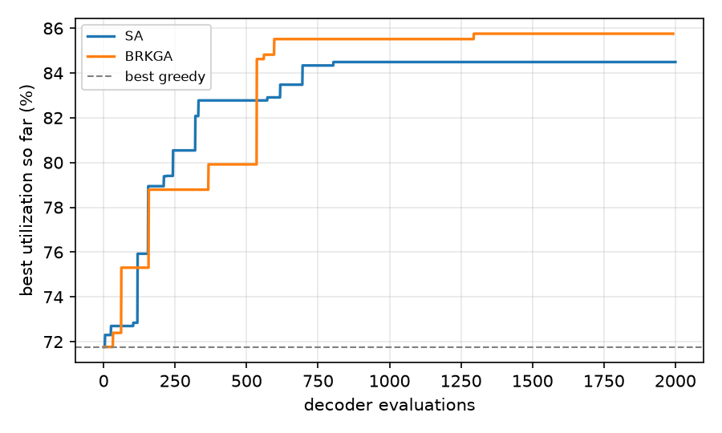

# E1 · Offline stacking plans

Mean utilization over 3 instances per row; search methods get 2000 decoder evaluations and start from the best greedy order. Every plan passed the independent feasibility check (bounds, overlap, top-down access, ≥ 75 % support).

| instance | greedy (min waste) | greedy (DBLF) | SA | BRKGA | time SA / BRKGA |
|---|---|---|---|---|---|
| perfect, 20 boxes | 73.6 % | 67.5 % | 85.5 % | 88.3 % | 7 s / 7 s |
| perfect, 30 boxes | 70.3 % | 67.4 % | 82.4 % | 80.3 % | 13 s / 13 s |
| perfect, 50 boxes | 66.8 % | 62.2 % | 74.0 % | 74.6 % | 25 s / 26 s |
| SKU mix, 60 boxes | 81.7 % | 88.0 % | 91.7 % | 93.3 % | 26 s / 25 s |

