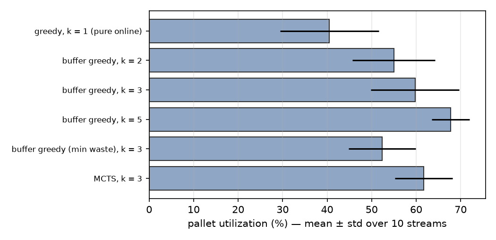
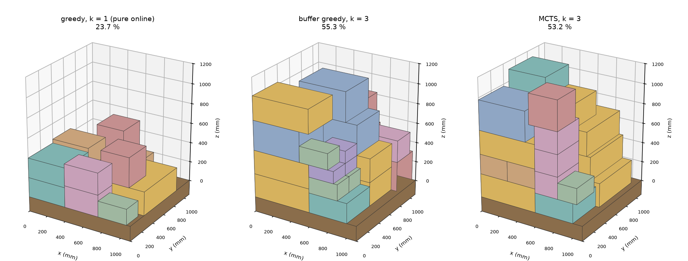

# E3 · Random (online) palletizing

10 random SKU streams; k = boxes visible on the conveyor. MCTS: 3 sampled futures × 16 UCT iterations per decision, greedy rollouts to the end of the episode. Every plan passed the independent feasibility check.

| policy | mean | std (pts) | worst | time per box |
|---|---|---|---|---|
| greedy, k = 1 (pure online) | 40.5 % | 11.1 | 23.7 % | 0.3 ms |
| buffer greedy, k = 2 | 55.0 % | 9.3 | 32.5 % | 0.5 ms |
| buffer greedy, k = 3 | 59.8 % | 9.9 | 42.0 % | 0.8 ms |
| buffer greedy, k = 5 | 67.7 % | 4.2 | 60.1 % | 1.3 ms |
| buffer greedy (min waste), k = 3 | 52.3 % | 7.5 | 38.2 % | 1.5 ms |
| MCTS, k = 3 | 61.7 % | 6.5 | 52.1 % | 611.7 ms |

MCTS vs. buffer greedy at k = 3: better on 5 of 10 streams, mean difference +1.9 pts.

